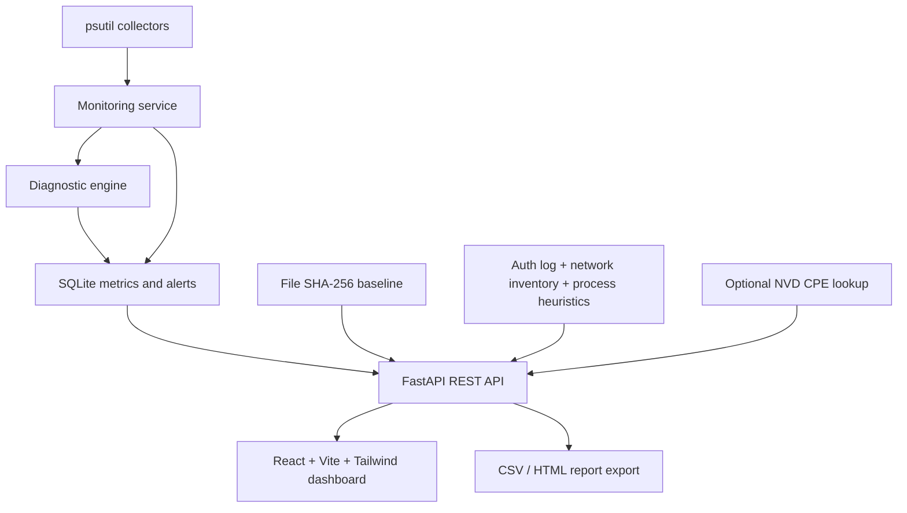

# Architecture and Data Flow

## Request lifecycle
1. Dashboard requests the current sample.
2. Collectors gather resource and host inventory data.
3. The diagnostic engine applies current thresholds and evaluates consecutive samples.
4. The service stores the sample and resulting alerts in SQLite.
5. API returns JSON to the dashboard.
6. User can review history, change thresholds, run defensive checks, or export reports.
