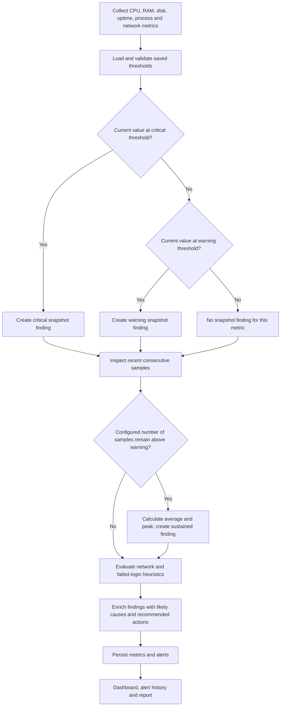

# Automated diagnostic flowchart

## Diagnostic logic
- Current CPU, RAM and disk values are compared with independent warning and critical thresholds.
- Sustained rules evaluate a configurable window of consecutive samples and report the average and peak value.
- CPU and RAM findings can mention the top process returned by the process collector.
- Findings contain a plausible cause and practical next action. These are triage hypotheses, not definitive root-cause analysis.
- Network connection counts and available failed-login logs are heuristic signals; they can produce false positives and do not prove compromise.
